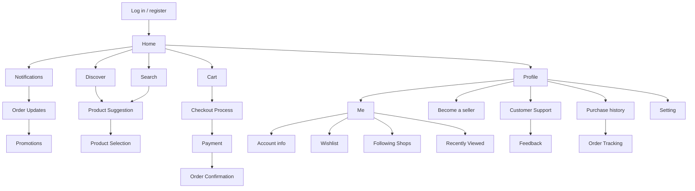

# OffBuy — E-Commerce Mobile UI/UX Design Case Study

  <b>A human-centered mobile e-commerce design built to eliminate visual clutter, resolve navigation fatigue, and offer upfront pricing transparency.</b>

  
  
  

---

## Table of Contents
* [1. Executive Overview](#1-executive-overview)
* [2. Problem Statement](#2-problem-statement)
* [3. Competitive UX Audit](#3-competitive-ux-audit)
* [4. Application Logical Flow](#4-application-logical-flow)
* [5. High-Fidelity Interface Mock-ups](#5-high-fidelity-interface-mock-ups)
* [6. Stakeholders & Market Ecosystem](#6-stakeholders--market-ecosystem)
* [7. Target Audience & Market Segments](#7-target-audience--market-segments)
* [8. Monetization Strategy](#8-monetization-strategy)
* [9. Marketing & Promotion Strategy](#9-marketing--promotion-strategy)
* [10. Proposed Technical Architecture (Java GUI)](#10-proposed-technical-architecture-java-gui)
* [11. Project Presentation & Documentation](#11-project-presentation--documentation)
* [12. Contributors](#12-contributors)
* [13. References](#13-references)

---

## 1. Executive Overview

**Course:** FSTM3064 Introduction to Programming (Foundation in Science and Technology)[cite: 3]

During and following the COVID-19 pandemic and the Movement Control Order (MCO) in Malaysia, consumer reliance on online shopping applications surged by up to 37%[cite: 3]. However, many dominant e-commerce platforms grew cluttered with aggressive commercial banners, multi-tiered voucher schemes, and confusing information architectures[cite: 3].

**OffBuy** is a mobile e-commerce application concept designed to provide a seamless, transparent, and user-friendly shopping experience[cite: 3]. Key innovations include:
* **Advanced In-App Search Engine:** Prominently accessible search bar equipped with advanced filtering, sorting, and intent interpretation to eliminate zero-result dead ends[cite: 3].
* **Augmented Reality (AR) Preview:** Interactive environment replicas using photo/video materials so shoppers can visualize how furniture fits in their living room or how makeup palettes complement their skin tone[cite: 3].
* **Decluttered Product Pages:** Focused strictly on essential product specifications, verified reviews, and stock availability without distracting voucher pop-ups[cite: 3].
* **Upfront Price & Fee Transparency:** Complete itemized visibility into merchandise subtotals, shipping fees, store discounts, and coin redemptions prior to checkout[cite: 3].
* **Authentic Review Validation:** Verified buyer feedback system to build consumer confidence and trust[cite: 3].

[Back to Top ↑](#offbuy--e-commerce-mobile-uiux-design-case-study)

---

## 2. Problem Statement

Modern mobile shoppers regularly face friction across four key touchpoints[cite: 3]:

1. **Complicated Navigation & Clutter:** Cluttered layouts and confusing navigation menus make locating specific goods or categories difficult, directly hindering transaction completion[cite: 3].
2. **Inconsistent Design Layouts:** Discrepancies in button placements, color schemes, and typographies across desktop and mobile views interrupt the purchasing flow and confuse users[cite: 3].
3. **Ineffective Search Engines:** When customers make minor spelling mistakes, poor search engines return zero-result pages or irrelevant listings, causing users to falsely assume products are out of stock[cite: 3].
4. **Payment Friction & Security Anxiety:** Difficulty locating alternative payment methods beyond credit/debit cards and fear of personal data leakage cause user anxiety and high cart abandonment[cite: 3].

[Back to Top ↑](#offbuy--e-commerce-mobile-uiux-design-case-study)

---

## 3. Competitive UX Audit

Before designing OffBuy, our team audited three leading e-commerce applications in Southeast Asia (Shopee, Lazada, and SHEIN)[cite: 3]:

| Platform | Key Usability Strengths | Observed UX Bottlenecks & Limitations |
| :--- | :--- | :--- |
| **Shopee** | • Effective use of white space on the home screen[cite: 3] • Strong merchant rating system and "Shopee Guarantee" protection[cite: 3] • Search by picture, search history, and "Buy Again" convenience[cite: 3] • Intuitive bottom navigation bar and top cart icon[cite: 3] | • Individual product pages are cluttered with voucher redemptions and shipping details that belong at checkout[cite: 3] • Poorly differentiated information hierarchy[cite: 3] • Tiny font sizes for prices and discounts fail to draw immediate attention[cite: 3] |
| **Lazada** | • Clean homepage contrast with bolded, emphasized product pricing and discounts[cite: 3] • Prominent "Collect Voucher" banner in the shopping cart[cite: 3] • Pre-checked basket items expedite checkout and reduce mental strain[cite: 3] • Superior visual hierarchy and search filters on listing pages[cite: 3] | • In-app wallet icon is poorly visible, making emergency balance access difficult[cite: 3] • Blue color scheme and commercial banners create visual clutter when scrolling downward[cite: 3] • Transaction history is buried beneath promotional areas[cite: 3] |
| **SHEIN** | • Strong category navigation applying Information-Foraging Theory (main tabs at top, subcategories on left)[cite: 3] • Combines UX Heuristics No. 2 and No. 9 effectively[cite: 3] • Integrated "Fit Finder" sizing tool reduces return rates[cite: 3] | • Excessive information density and lack of blank space result in an overcrowded interface[cite: 3] • Search filter contains too many unorganized options[cite: 3] |

[Back to Top ↑](#offbuy--e-commerce-mobile-uiux-design-case-study)

---

## 4. Application Logical Flow

The architecture diagram below maps the complete user pathway across OffBuy[cite: 3]:

### Step-by-Step User Journey

1. **Registration:** Customers create a new account by providing their name, email, password, and date of birth[cite: 3].
2. **Home Page:** Users browse product categories, view clear ratings, and access core navigation tabs (Home, Discover, Notifications, Cart, Profile)[cite: 3].
3. **Notifications:** Real-time alerts for order confirmations, shipping updates, delivery status, and promotional campaigns[cite: 3].
4. **Profile:** Users manage personal details, wishlists, followed shops, recently viewed items, customer support feedback, and purchase history[cite: 3].
5. **Search:** Keyword-driven product lookup equipped with multi-criteria sorting and filtering[cite: 3].
6. **Product Suggestion:** Automated recommendations tailored to browsing history, trending items, and past purchases[cite: 3].
7. **Product Selection:** Detailed inspection of product thumbnails, descriptions, stock counts, size/color variations, and verified buyer reviews before adding to cart[cite: 3].
8. **Shopping Cart:** Users review selected items, adjust quantities via dropdowns, or delete unwanted products prior to checkout[cite: 3].
9. **Checkout Process:** Users verify shipping addresses, select delivery tiers, and apply store discounts or vouchers[cite: 3].
10. **Payment Processing:** Secure transaction execution via credit/debit cards, e-wallets, online banking, or physical cash on delivery[cite: 3].
11. **Order Confirmation:** Instant receipt generation via email and in-app notification containing order ID, itemized costs, and estimated delivery date[cite: 3].

[Back to Top ↑](#offbuy--e-commerce-mobile-uiux-design-case-study)

---

## 5. High-Fidelity Interface Mock-ups

### 1. Onboarding & Authentication
A clear, user-friendly login and registration flow with quick password recovery[cite: 3].

  
  &nbsp;&nbsp;&nbsp;&nbsp;
  
  &nbsp;&nbsp;&nbsp;&nbsp;
  

* **Login Page:** Clean credential input fields with a password visibility toggle, direct registration link, and password reset trigger[cite: 3].
* **Create New Account Page:** Structured input fields for Name, Email, Password, Repeat Password, and Date of Birth calendar selector[cite: 3].
* **Forgot Password Page:** Email verification dispatch that sends a password reset link and returns users smoothly to the login screen[cite: 3].

### 2. Browsing, Product Details & Cart Management
Consistent layouts and uncluttered interfaces keep the focus on products and pricing[cite: 3].

  
  &nbsp;&nbsp;&nbsp;&nbsp;
  
  &nbsp;&nbsp;&nbsp;&nbsp;
  

* **Home Page:** Features a top search bar with image-scan icon, promotional banner, quick-access utility grid (Delivery, Bills, Vouchers, Coins, Wallet, Live, Help Center, Category), and "Hot Deals" / "For You" product feeds[cite: 3].
* **Individual Product Page:** Displays product imagery, color swatches, size selectors (`XS` to `XL`), expandable description, authentic buyer reviews, seller rating badge, remaining stock count (`15 items left`), and an "Add to Cart" button[cite: 3].
* **Shopping Cart Page:** Organized list with in-cart search, sorting filter, independent item selection checkboxes, quantity dropdown steppers, top delete icon, and sticky total summary[cite: 3].

### 3. Transparent Checkout & User Profile
Upfront cost breakdowns eliminate hidden fees and reduce shopping cart abandonment[cite: 3].

  
  &nbsp;&nbsp;&nbsp;&nbsp;
  

* **Checkout Page:** Highlights the recipient's delivery address at the top with an `Edit` button, itemized store orders, shipping fees, store discounts, payment method selector, voucher input, coin redemption toggle, and complete `Price Details` summary[cite: 3].
* **Profile Page:** Displays wallet balance, coin count, `Top Up` button, quick links (Wishlist, Following Shops, Recently Viewed), order tracking pipeline (`To Pay`, `To Ship`, `To Receive`, `To Rate`, `Return & Refund`), Customer Support, Become a Seller, and Settings[cite: 3].

[Back to Top ↑](#offbuy--e-commerce-mobile-uiux-design-case-study)

---

## 6. Stakeholders & Market Ecosystem

The Malaysian e-commerce market expanded rapidly following the 2020 Movement Control Order (MCO), with platforms like Shopee (108.3M visits in Feb 2024) and Lazada (24.6M visits) demonstrating massive consumer adoption[cite: 3]. OffBuy's ecosystem balances two primary stakeholder groups[cite: 3]:

* **Internal Stakeholders (Employees & Owners):** Smooth departmental operations rely on well-supported employees[cite: 3]. Preventing understaffing and burnout directly improves software quality and customer service[cite: 3].
* **External Stakeholders (Customers & Competitors):** Facing competition from feature-heavy apps like SHEIN requires continuous app updates, feature refinement, and active monitoring of customer feedback to fix software bugs[cite: 3].

[Back to Top ↑](#offbuy--e-commerce-mobile-uiux-design-case-study)

---

## 7. Target Audience & Market Segments

1. **Ordinary Everyday Shoppers:** Consumers purchasing daily essentials, groceries, and skincare who want to compare prices across stores without paying physical retail markups (rent, utilities)[cite: 3].
2. **Physical Store Owners:** Brick-and-mortar retailers utilizing OffBuy's **buy-in-bulk wholesale option** to source inventory at lower prices than traditional suppliers, supported by direct buyer-seller chatrooms with photo/video sharing[cite: 3].
3. **Workaholics & Busy Professionals:** Time-poor individuals who rely on fast mobile ordering and same-day parcel dispatch (before 12:00 AM for intra-state orders)[cite: 3].
4. **Cross-Border & Niche Product Seekers:** Buyers searching for items unavailable locally by connecting with international sellers from Mainland China, Indonesia, and Vietnam[cite: 3].

[Back to Top ↑](#offbuy--e-commerce-mobile-uiux-design-case-study)

---

## 8. Monetization Strategy

OffBuy sustains platform development and marketplace operations through three revenue streams[cite: 3]:

1. **Premium Listing Options (In-App Advertising):**
   * Sellers can pay to boost best-selling or new test products to the top of keyword search results[cite: 3].
   * All boosted items display a clear **"Ad"** badge to prevent user confusion, and sellers control their own ad duration and credit top-ups[cite: 3].
2. **Transaction & Commission Fees:**
   * **2% Transaction Fee:** Automatically deducted from the seller's payout (calculated on total order amount including shipping) upon order completion to cover payment gateway costs[cite: 3].
   * **3% Commission Fee:** Applied to established merchants who have been selling on OffBuy for more than five months since their first listing, funding software updates and engineering talent[cite: 3].
3. **Bulk E-Voucher Sales:**
   * Sellers purchase promotional vouchers in bulk from OffBuy to distribute as random rewards or interactive mini-games (e.g., spinning wheel rewards), generating commission revenue while boosting customer retention[cite: 3].

[Back to Top ↑](#offbuy--e-commerce-mobile-uiux-design-case-study)

---

## 9. Marketing & Promotion Strategy

1. **Social Media Marketing:** Targeted campaigns on Facebook and Instagram aimed at users who recently searched for items online without completing a purchase[cite: 3].
2. **Search Engine Optimization (SEO) & Google Ads:** Keyword-targeted pop-up advertisements featuring product prices and direct App Store download links to drive high-intent traffic[cite: 3].
3. **Organic Content & Influencer Marketing:** Encouraging verified buyers to post photo/video product reviews (organic user-generated content) alongside PR gift collaborations with social media influencers to build brand authority[cite: 3].
4. **User Loyalty Programs:** A point-based reward system scaled to transaction value, paired with birthday gift cards and exclusive vouchers to maximize long-term retention[cite: 3].

[Back to Top ↑](#offbuy--e-commerce-mobile-uiux-design-case-study)

---

## 10. Proposed Technical Architecture (Java GUI)

To demonstrate how the OffBuy interface translates into a functional Java desktop/mobile prototype, the UI screens map directly to Java Swing (`javax.swing`) and AWT (`java.awt`) components[cite: 3]:

| Java Component / Class | Implementation in OffBuy |
| :--- | :--- |
| **`JTextField`** | Captures user text input on the Login page, Sign-Up page, Home search bar, and Cart search bar[cite: 3]. |
| **`JLabel`** | Displays input field titles, category headers, and text labels so users clearly understand each form box[cite: 3]. |
| **`JButton` (with Icon & Word)** | • **Icon Buttons:** Neon-brown icons on a light background (Home & Profile grids) allow quick visual recognition without reading tiny text[cite: 3]. • **Word Buttons:** Prominent text buttons (`Add to Cart`, `Check Out`, `Place Order`) highlight primary purchasing actions[cite: 3]. |
| **`JPasswordField`** | Encrypts and masks password characters on the Login and Create Account screens to protect user privacy[cite: 3]. |
| **`JRadioButtons` (Grouped & Ungrouped)** | • **Ungrouped:** Used in the Shopping Cart so buyers can select multiple individual products simultaneously[cite: 3]. • **Grouped:** Used at the bottom bar (`All`) for single-click select-all checkout[cite: 3]. |
| **`JComboBox`** | Provides drop-down quantity selectors on the Cart and Checkout pages so users can adjust item counts without returning to the product page[cite: 3]. |
| **`JTabbedPane`** | Powers the bottom navigation bar (`Home`, `Discover`, `Notification`, `Cart`, `Profile`) for instant tab switching[cite: 3]. |
| **`BorderLayout`** | Divides screens into `North` (search/header), `Center` (content feed), and `South` (navigation/checkout bar) regions[cite: 3]. |
| **`GridLayout`** | Organizes category shortcut icons and product cards into neat, aligned rows and columns[cite: 3]. |
| **`java.awt.Color`** | Uses `setBackground()` for comfortable light-toned backgrounds and `setForeground()` to create typographic contrast (e.g., black review titles vs. grey review counts)[cite: 3]. |
| **`java.awt.Font`** | Differentiates visual hierarchy across headers, bold reviewer names, and smaller comment body text[cite: 3]. |

[Back to Top ↑](#offbuy--e-commerce-mobile-uiux-design-case-study)

---

## 11. Project Presentation & Documentation

### Video Presentation
Click the badge below to watch our group's video presentation on Google Drive[cite: 2, 3]:

  

* **Direct Video Link:** [https://drive.google.com/file/d/1jh1Xe4WQP0wJvdOJRtxNez3QX66S0m_d/view?usp=sharing](https://drive.google.com/file/d/1jh1Xe4WQP0wJvdOJRtxNez3QX66S0m_d/view?usp=sharing)[cite: 3]

### Coursework Report
* [Download Full Coursework Report (.docx)](docs/Programming%20Assignment%202.docx)[cite: 3, 6]

[Back to Top ↑](#offbuy--e-commerce-mobile-uiux-design-case-study)

---

## 12. Contributors

| Student Name | Student ID | Assigned Responsibilities & Contributions |
| :--- | :---: | :--- |
| **Hoh Xin Hui** | 23080609 | • Suggestion on Coding Techniques • Mock-up Design • Video Presentation (Marketing & Promotion, Suggestion on Coding Techniques)[cite: 3] |
| **Lim Feng Wei** | 23062334 | • Problem Statement • Review of Existing Applications (Shopee, Lazada, SHEIN) • Proposal of Application • Video Presentation (Problem Statement & Existing Application Reviews)[cite: 3] |
| **Sian Yi Xuan** | 23099609 | • Stakeholders Analysis • Market Reach & Target Audience • Monetizing Strategy • Video Presentation (Stakeholders, Target Audience & Monetizing Strategy)[cite: 3] |
| **Teoh En Yi** | 23051105 | • Mock-up Design • Logical Flow Diagram & Architecture • Video Presentation (Application Proposal & Mock-up Design)[cite: 3] |

[Back to Top ↑](#offbuy--e-commerce-mobile-uiux-design-case-study)

---

## 13. References

* Fernando, J. (2024a, February 20). *What are stakeholders: definition, types, and examples*. Investopedia. [https://www.investopedia.com/terms/s/stakeholder.asp](https://www.investopedia.com/terms/s/stakeholder.asp)[cite: 3]
* Fernando, J. (2024b, March 6). *What is a payment gateway? how it works and example*. Investopedia. [https://www.investopedia.com/terms/p/payment-gateway.asp](https://www.investopedia.com/terms/p/payment-gateway.asp)[cite: 3]
* Jain, S. (2020, April 26). *How Shein's UX Helps in reducing the Number of Returns*. Medium. [https://medium.com/@sheryansh011095/how-sheins-ux-helps-in-reducing-the-number-of-returns-6e0b7b9d62a2](https://medium.com/@sheryansh011095/how-sheins-ux-helps-in-reducing-the-number-of-returns-6e0b7b9d62a2)[cite: 3]
* Jasmine Heather Tay. (2019, March 12). *A UX case study on Shopee (and my redesign of it)*. Medium; Prototypr. [https://blog.prototypr.io/a-ux-case-study-on-shopee-and-my-redesign-of-it-cb0cabd0d8d0](https://blog.prototypr.io/a-ux-case-study-on-shopee-and-my-redesign-of-it-cb0cabd0d8d0)[cite: 3]
* LaFleur, G. (2022, December 5). *10 e-commerce marketing strategies for your business*. TechTarget. [https://www.techtarget.com/searchcustomerexperience/tip/E-commerce-marketing-strategies-for-your-business](https://www.techtarget.com/searchcustomerexperience/tip/E-commerce-marketing-strategies-for-your-business)[cite: 3]
* Loh, L. W. (2021, February 9). *Designing a Faster Shopping Experience for the Lazada App*. Medium. [https://liweiloh.medium.com/designing-a-faster-shopping-experience-for-the-lazada-app-10d0d7baed6](https://liweiloh.medium.com/designing-a-faster-shopping-experience-for-the-lazada-app-10d0d7baed6)[cite: 3]
* *Planning your digital marketing strategy: Traffic & Quality*. (n.d.). Click Pilot. [https://www.clickpilot.co.uk/blog/planning-your-digital-marketing-strategy-why-its-crucial-to-focus-on-traffic-and-quality/](https://www.clickpilot.co.uk/blog/planning-your-digital-marketing-strategy-why-its-crucial-to-focus-on-traffic-and-quality/)[cite: 3]
* Seet, F. (2023, September 18). *UI/UX Audit: Shopee vs Lazada*. Snappymob Blog. [https://blog.snappymob.com/ui-ux-audit-shopee-vs-lazada](https://blog.snappymob.com/ui-ux-audit-shopee-vs-lazada)[cite: 3]
* Takahashi, L. (2022, October 4). *UX/UI Case study: Shein Redesign*. Medium. [https://bootcamp.uxdesign.cc/ux-ui-case-study-shein-redesign-134e37cd3935](https://bootcamp.uxdesign.cc/ux-ui-case-study-shein-redesign-134e37cd3935)[cite: 3]
* Tambe, R., & Bhat, S., Jayaram. (n.d.). *13 Problems Faced by Customers While Shopping Online and How To Solve It*. Smart Sight Innovations. [https://www.smartsight.in/technology/problems-faced-customers-shopping-online-how-solve/](https://www.smartsight.in/technology/problems-faced-customers-shopping-online-how-solve/)[cite: 3]
* Teck, S. P. (2021, March 12). *Case study: Creating a better Lazada experience*. Medium. [https://bootcamp.uxdesign.cc/creating-a-better-lazada-experience-70251b1b58ab](https://bootcamp.uxdesign.cc/creating-a-better-lazada-experience-70251b1b58ab)[cite: 3]
* *Top retail websites in Malaysia - Top rankings February 2024*. (2024, March 12). Semrush. [https://www.semrush.com/website/top/malaysia/e-commerce-and-retail/](https://www.semrush.com/website/top/malaysia/e-commerce-and-retail/)[cite: 3]
* *View of IMPACT OF COVID-19 ON MALAYSIAN E-COMMERCE*. (n.d.). International Journal on Recent Trends in Business and Tourism (IJRTBT). [https://ejournal.lucp.net/index.php/ijrtbt/article/view/1464/1624](https://ejournal.lucp.net/index.php/ijrtbt/article/view/1464/1624)[cite: 3]
* *What is Content Marketing? Content Marketing Definition*. (n.d.). Mailchimp. https://mailchimp.com/marketing-glossary/content-marketing/[cite: 3]

[Back to Top ↑](#offbuy--e-commerce-mobile-uiux-design-case-study)
